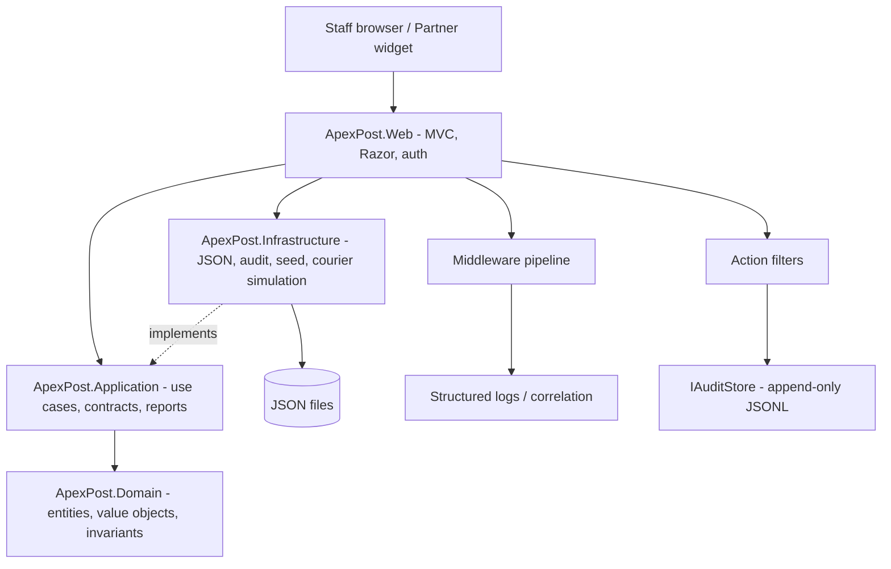

# ApexPost Logistics — Design and Architecture

## 1. Design goals and scope

This solution follows the Assessment 02 constraints: .NET 10, C# 14, nullable references enabled, ASP.NET Core MVC, no database/ORM, JSON repositories behind interfaces, custom cookie authentication (no ASP.NET Core Identity), async I/O with cancellation, middleware and action filters, auditability, and testable business rules.

The architecture is **pragmatic DDD with clean/layered dependency direction**. It deliberately does not introduce microservices, CQRS, event sourcing, a message broker, or a generic mediator framework because none is needed for this week's single-process JSON-backed assessment.

## 2. Architecture diagram



Dependency direction: Domain has no project references. Application references Domain. Infrastructure references Application and Domain to implement contracts. Web composes the graph and references the layers. Tests reference the layers and Web to exercise behavior.

## 3. Domain model and aggregate decisions

```mermaid
classDiagram
    class Branch { Id; Code; Name; Region; OpeningHours; Status }
    class Counter { Id; Name; IsActive }
    class Staff { Id; Name; Email; Role; HomeBranchCode; Status; PasswordHash }
    class Product { Id; Sku; Category; UnitPrice; TaxCategory }
    class StockItem { Id; BranchCode; Sku; Quantity }
    class CounterTransaction { Id; BranchCode; CounterId; ClerkId; Lines; Totals; Status }
    class TransactionLine { Id; Kind; Description; Quantity; UnitPrice; TaxRate; LineTotal }
    class Shipment { Id; Kind; WeightKg; Dimensions; DestinationZone; ServiceLevel; Price }
    class MoneyOrder { Id; Amount; Fee; BranchCode; CounterTransactionId; VerificationId }
    class IdentityVerification { Id; BranchCode; CounterTransactionId; DocumentType; MaskedDocumentNumber; Result }
    Branch "1" o-- "1..*" Counter
    CounterTransaction "1" *-- "0..*" TransactionLine
    Product "1" --> "0..*" StockItem : SKU / branch quantity
    CounterTransaction "1" <-- "0..*" MoneyOrder : same transaction link
    CounterTransaction "1" <-- "0..*" IdentityVerification : same transaction link
```



- **Entities:** Branch, Staff, Product, StockItem, Shipment, MoneyOrder, IdentityVerification and CounterTransaction have identity and lifecycle/state.
- **Value objects:** `Money`, `Weight`, `BranchCode`, `Sku` and `Address` represent values, not independent identity.
- **Aggregate boundary:** CounterTransaction owns its line collection and lifecycle operations. StockItem is a separate consistency boundary because inventory is branch/SKU scoped and can be updated by many transactions.
- **Mixed basket:** composition through `TransactionLine.Kind`, not a deep inheritance tree. Retail, shipping and money-order line types share the line contract but preserve their own workflow and validation.
- **Business invariants:** stock cannot be negative; only active staff can transact at their assigned active branch; only open transactions accept lines; high-value money orders require a successful verification linked to the same counter transaction; parcel weight cannot exceed the selected rate's limit; void/refund require manager/admin authorization and a reason.

## 4. Application and infrastructure boundaries

Application services coordinate workflows and depend only on repository/service abstractions. Domain contains the pricing and tax rules and transaction invariants. JSON serialization, file paths, PBKDF2 implementation, audit persistence, seed initialization and simulated courier integration remain in Infrastructure. Controllers are orchestration adapters and do not calculate authoritative transaction totals.

`IRepository<T>` has a meaningful `class, IEntity` constraint. Reports use a low-stock specification. The JSON implementation uses a type-specific file and shared per-path semaphore, async file APIs, cancellation, temporary-file writes and atomic replacement. Corrupt JSON raises a clear error and is never silently replaced with an empty collection.

## 5. Middleware pipeline order

The pipeline is registered in `Program.cs` in this order:

```mermaid
flowchart TD
    A[Correlation ID] --> B[Global exception handling]
    B --> C[Request timing and structured logs]
    C --> D[Security headers]
    D --> E[HSTS / HTTPS redirect]
    E --> F[Maintenance mode]
    F --> G[Static files / routing]
    G --> H[CORS]
    H --> I[Rate limiting]
    I --> J[IP restriction]
    J --> K[API key validation]
    K --> L[Cookie authentication]
    L --> M[Authorization policies]
    M --> N[MVC filters and action]
    F -. bypass for health .-> O[/health and /health/live]
```

The pipeline is registered in `Program.cs` in this order:

1. **Correlation ID** — validates/reuses a safe `X-Correlation-Id` or creates one; sets `TraceIdentifier`, echoes the response header and adds a logging scope.
2. **Global exception middleware** — converts unhandled exceptions to safe Problem Details with trace ID; no stack trace is sent in production. Request-abort cancellation is handled separately.
3. **Request timing/logging** — structured request method/path/status/duration/correlation logging in `try/finally`.
4. **Security headers** — `OnStarting` sets CSP, `X-Content-Type-Options`, `X-Frame-Options`, `Referrer-Policy` and Permissions Policy.
5. **HSTS outside Development** and **HTTPS redirection**.
6. **Maintenance mode** — returns 503 with `Retry-After`, except health endpoints.
7. **Static files and routing** — routing must run before endpoint metadata-dependent security middleware.
8. **CORS** — restricted to the configured partner widget origin and GET/approved headers.
9. **IP restriction** — applies to `/Admin`, branch/staff administration metadata and `/integration` paths; denies non-allowlisted clients with 403.
10. **API-key validation** — only endpoints marked with `RequireApiKeyAttribute`; missing/invalid key gives 401; unconfigured server key gives 500; comparisons use `CryptographicOperations.FixedTimeEquals`. A partner-specific key can be configured under `Integration:Partners:<partnerId>:ApiKey`.
11. **Rate limiter** — login fixed-window policy and an authenticated-partner partition (partner identity is set only after key validation); 429 responses include `Retry-After`.
12. **Cookie authentication** — validates the signed cookie and claims.
13. **Authorization** — roles and policies are enforced before controller execution.
14. **Endpoint execution** — MVC controllers and health checks.

`Use`, `Run`, `Map`, `MapWhen` and `UseWhen` are demonstrated deliberately: `Use` registers the main middleware chain and conditional context tagging; `MapWhen` branches integration requests while continuing to endpoint execution; `Map` creates a liveness branch; `Run` is terminal for that liveness response. `MapHealthChecks` provides `/health`.

### Proxy / forwarded-header risk

Forwarded headers are not blindly trusted or enabled by default. If deployed behind a reverse proxy, configure `ForwardedHeadersOptions` with explicit `KnownProxies`/`KnownNetworks` and apply `UseForwardedHeaders` before correlation, HTTPS redirection and IP restriction. Otherwise clients may spoof forwarded IP/protocol headers, or the application may evaluate the proxy's address instead of the real client address. Never trust arbitrary `X-Forwarded-For` from the public internet.

## 6. Middleware versus action filters

| Concern | Mechanism | Why |
|---|---|---|
| Correlation ID, exception safety, request timing, maintenance, security headers | Middleware | Applies across HTTP requests, including non-MVC endpoints. |
| API key and IP allowlist | Middleware plus endpoint metadata | Protects integration/admin endpoint boundaries before action execution. |
| Authentication, authorization, CORS, rate limiting, health | ASP.NET Core middleware/endpoints | Framework mechanisms are designed for these concerns. |
| Audit of MVC actor/action/route/result/duration | `AuditActionFilter` (`IAsyncActionFilter`) | Needs MVC controller/action/route/result context. |
| Consistent invalid ModelState response | `ValidationActionFilter` | Operates on MVC binding/model validation results. |
| Slow MVC action warning | `PerformanceActionFilter` | Measures action execution separately from total request latency. |
| Optional branch isolation | `SameBranchOnly` authorization policy | Uses claims and requested route branch before action execution. |

The audit filter stores only actor ID, role, branch, controller/action, allowlisted route values, result status, duration, correlation ID, timestamp and outcome. It does not serialize request bodies or log passwords, full document numbers, API keys, or card data. Audit records are appended as JSON Lines through `IAuditStore`; write failures are critical operational events and must be monitored.

## 7. Security and audit threat model

| Threat | Mitigation | Verification evidence |
|---|---|---|
| Password disclosure | PBKDF2-SHA256 with random 16-byte salt and 210,000 iterations; only hash persisted | Login flow; inspect Staff JSON contains hashes only |
| Session theft over HTTP / script access | Secure, HttpOnly, SameSite=Lax cookie; HTTPS redirect; HSTS outside Development | Cookie configuration and HTTPS smoke test |
| CSRF | Antiforgery token on MVC POST actions | MVC form tests / manual POST check |
| Privilege escalation | Role attributes and policy; manager/admin domain rule for void/refund | Integration test for clerk void; domain tests |
| Cross-branch access | Staff home-branch claim, branch filtering and `SameBranchOnly` policy | Branch-scoped controller tests and manual role tests |
| Integration abuse | API key from user-secrets/config, constant-time comparison, partner rate limit | 401 / 429 integration tests |
| Network exposure | Configured IP allowlist on admin/integration; default config is loopback only | 403 integration test; deployment allowlist review |
| Browser script/content injection | CSP, nosniff, frame denial, referrer policy, server-side validation and Razor encoding | Security header test and input review |
| Identity-data over-collection | Only masked document number is persisted; no request body in audit | Domain masking test and JSON inspection |
| Correlation/header injection | Restricted character set and max length for incoming correlation ID | Correlation integration test |
| Denial of service / overload | Login and partner rate limiting; bounded courier concurrency; cancellation and timeout | 429 test and performance tests to add on target SDK |
| Corrupt JSON / partial writes | Parse errors surfaced; temporary file and atomic replace; no automatic reset | Infrastructure tests should be run on target SDK |

CORS is **not** an authentication or authorization boundary. Non-browser clients can ignore CORS. API keys, IP restrictions, rate limits and authorization remain independent controls.

## 8. Performance and concurrency decisions

- **Async/cancellation:** JSON reads/writes use async APIs and receive cancellation tokens from MVC/use cases to Infrastructure. The simulated courier service supports cancellation.
- **`Task.WhenAll`:** dashboard reads independent repositories concurrently; money-order report loads orders and verifications concurrently.
- **`SemaphoreSlim`:** per-file JSON write coordination, shared stock mutation gate and a four-operation maximum for simulated courier calls.
- **`ValueTask`:** rate cache returns a `ValueTask` so hot cache hits can avoid allocating a new task. This is a small demonstration optimization; measure before claiming material throughput gains.
- **Cache:** shipment rates are immutable in the demonstration and cached for process lifetime. If rate editing is added, introduce explicit invalidation/versioning before enabling updates.
- **Timeouts:** shipping preview has a three-second linked timeout; integration tracking has a two-second timeout and returns 504 separately from client cancellation.
- **Rate limiting:** login is limited to five attempts per IP per ten minutes; partner calls are limited to 60/minute per configured key partition. Production deployment should use a distributed limiter if multiple instances are introduced.
- **No blocking waits:** application source must not use `.Result`, `.Wait()` or `Thread.Sleep`.

### JSON concurrency limitations

Locks coordinate only within one process. They do not coordinate multiple app instances or external writers. Multi-file workflows (e.g., decrement stock and save a transaction, or money order plus verification plus transaction) cannot be truly atomic in plain JSON. Retail stock changes include a best-effort compensating write even when the transaction JSON write fails; remaining cross-file failure windows are documented. Money orders remain `PendingPayment` until the containing transaction is paid, then transition to `Issued`; void/refund cancels linked orders. The correct next-week migration is a database transaction with concurrency tokens/row versioning, not pretending JSON is a database.

## 9. Dependency injection lifetimes

| Lifetime | Examples | Reason |
|---|---|---|
| Singleton | `IRepository<T>`, `IAuditStore`, password service, rate cache, simulated courier, domain notifications, low-stock policy | Stateless or internally synchronized process-level services. |
| Scoped | `ICounterService`, `IReportService`, MVC action filters | One request's use-case/action execution. |
| Framework-managed | MVC controllers, auth middleware, health checks | Created and invoked by ASP.NET Core. |

No scoped application service is captured by constructor injection into conventional middleware. Middleware uses singleton-safe dependencies only. If future middleware needs scoped services, inject them into `InvokeAsync` or use `IMiddleware` with the appropriate lifetime.

## 10. Advanced C# 14 feature mapping

| Feature | Implementation / use case | Rationale |
|---|---|---|
| Records and value objects | `Money`, `Weight`, `BranchCode`, `Sku`, `Address`, immutable `TransactionLine` | Value equality and validated domain values |
| Pattern matching | `BusinessRules.TaxRate` and service-level pricing multipliers | Clear mapping from enum to rule |
| C# 14 extension members | `DecimalMoneyExtensions` with `RoundMoney()` | Centralizes monetary rounding semantics |
| `field` keyword | Trimmed `Branch.Name` property | Demonstrates validation/normalization without explicit backing-field boilerplate |
| Generics and constraints | `IRepository<T> where T : class, IEntity`; report `ISpecification<T>` | Reusable persistence and filtering contracts with meaningful constraints |
| Delegates / `Func` / `Predicate` | `MoneyOrderPolicy.RequiresIdentityVerification`, `LowStockRule.IsLow` | Configurable rules without duplicating conditionals |
| Events / observer | `DomainNotifications` events for completed/voided transactions, low stock and money orders | Decoupled simulated notifications |
| Custom attributes/reflection cache | `RequiredValueAttribute`, `ReflectionValidator` with `ConcurrentDictionary<Type, PropertyInfo[]>` | Cached metadata and consistent domain-object validation |
| Async/await + cancellation | Controller → application → repository/courier APIs | Responsive I/O and cooperative cancellation |
| `Task.WhenAll` | Dashboard and money-order report reads | Concurrent independent reads |
| `SemaphoreSlim` | JSON writes, stock mutation and courier concurrency | Prevents unsafe overlapping writes within one process and bounds simulated calls |
| `ValueTask` + cache | `IRateCache.GetRatesAsync` | Efficient hot reads; impact must be measured before claiming a gain |
| Cancellation vs failure / timeout | `OperationCanceledException` handling and linked CTS timeouts | Distinguishes client cancellation from slow integration failure |

## 11. Pricing, tax and notifications

Shipping uses `IShippingPricingStrategy` and `ZoneRateShippingPricingStrategy`; the strategy reads configured zone/service rates, applies shipment-kind and service-level rules, and rejects weight above the selected service's maximum. Tax is a separate enum-based policy with standard, reduced and zero-rated categories. All amounts use `decimal` and two-decimal rounding.

`DomainNotifications` is a small in-process observer. It simulates notification delivery through structured logs. It is not a durable queue; production delivery belongs behind an outbox/queue when later assessment weeks introduce persistence and integration infrastructure.

## 12. SOLID mapping

- **SRP:** domain invariants, application orchestration, JSON storage, authentication, middleware and filters have separate responsibilities.
- **OCP:** pricing behavior is behind `IShippingPricingStrategy`; report filters are specifications/policies.
- **LSP:** repository and pricing implementations must honor their interface contracts; JSON implementations do not expose implementation details to callers.
- **ISP:** small interfaces (`IAuditStore`, `ICourierService`, `IRateCache`, `ICounterService`, `IReportService`) avoid forcing unrelated methods on consumers.
- **DIP:** Application depends on Domain and abstractions; Infrastructure implements abstractions; Web is the composition root.

## 13. ADR index

See `docs/adr/` for the Week 2 decisions:
1. Layered architecture and pragmatic DDD
2. JSON repository and single-process concurrency boundary
3. Mixed transaction composition and aggregate boundaries
4. Shipping pricing strategy and tax policy
5. Cookie authentication and password hashing
6. Middleware ordering and endpoint metadata
7. Action-filter audit and append-only JSONL
8. Performance, bounded concurrency and caching

## 14. Known limitations before submission

- The authoring environment did not contain `dotnet`, so the Release build and tests were not executed here. Target-machine verification is mandatory.
- JSON storage is for the single-process lab scope, not production multi-instance financial processing.
- The identity-verification result is simulated by the authorized counter workflow; no external identity provider is integrated.
- Courier rate/tracking is simulated and must not be represented as a real carrier integration.
- Production first-administrator provisioning, distributed rate limiting, durable notification delivery, backups, monitoring and database transactions belong to deployment/next-week scope.
